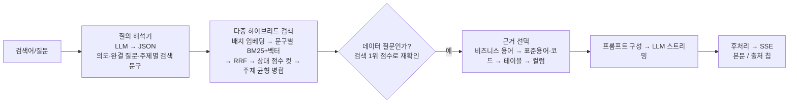

# 폐쇄망 데이터 카탈로그의 질의 해석 기반 AI 검색 · AI 개요

> 기간: 2026.10 – 2026.11 (약 2주) · 상태: 고객사 적용 진행 중 (운영 전)
>
> 담당: 기획부터 설계, 품질 평가까지 맡았고, 구현은 Claude Code와 함께 했습니다. 임베딩·하이브리드 검색 기반은 팀원이 구현했고, 전체 틀을 함께 설계하고 결과를 검증했습니다.

## 한 줄 요약
LLM이 질문을 먼저 **해석**하고, 그 해석으로 카탈로그 메타데이터를 **하이브리드 검색**한 뒤, 검색된 근거만으로 **AI 개요와 AI 대화 답변**을 만듭니다. 특정 LLM에 묶이지 않습니다.

## 문제
- 기존 AI 대화는 질문 문장을 그대로 검색했습니다. 그래서 의도와 다른 근거가 붙었습니다.
  - 예: "공무원이 찾아볼 만한 데이터"를 물으면 민간 직원 데이터가 나왔습니다.
- 통합검색에는 검색 결과를 요약해 주는 영역이 없었습니다.

## 제약 조건
- 고객사 **폐쇄망**에 설치됩니다.
- 고객사가 가진 **온프레미스 LLM**을 붙일 수 있어야 합니다. LLM마다 Tool Calling 지원 여부가 다릅니다.
- 개발 환경: NVIDIA DGX Spark에서 vLLM으로 Qwen 계열 모델 서빙

## 구조

- 검색 대상: 카탈로그 메타데이터 약 3,100건 (컬럼, 표준용어, 테이블, 코드, 비즈니스 용어, 게시글)
- 임베딩: 한국어 임베딩 모델 KURE-v1 (1024차원, 별도 서버)
- 저장: Elasticsearch 한 인덱스에 벡터·텍스트 필드. 유형별로 따로 검색한 뒤 합쳐, 수가 많은 컬럼이 상위를 독점하지 않게 함
- 모든 LLM 호출은 OpenAI 호환 API 기준의 공통 연결부를 지납니다. 모델 교체는 설정 변경으로 끝납니다.

## 핵심 설계 결정

### 1. 서버가 검색을 주도하고, LLM은 해석과 글쓰기만 맡는다
- **선택지:** LLM이 도구(Tool Calling·MCP)로 직접 검색 vs 서버가 검색 주도
- **결정:** 서버 주도. LLM은 검색 문구 JSON 생성과 답변 작성만 합니다.
- **이유**
  - 고객사 LLM마다 Tool Calling 지원이 다릅니다. 개발 서버도 JSON 응답 형식만 지원했습니다.
  - 검색 과정을 서버가 쥐고 있어야 단계별로 평가하고 재현할 수 있습니다.

### 2. LLM 프레임워크 없이 필요한 계층만 직접 구성
- **이유:** 폐쇄망 설치 솔루션은 의존성이 하나 늘 때마다 도입·검증·유지 비용이 생깁니다.
- **직접 만든 계층:** LLM 연결부(JSON 모드·스트리밍·시간 제한·재시도), 질의 해석기, 하이브리드 다중 검색, 근거 선택기, 프롬프트 빌더, 후처리, SSE 응답

### 3. "데이터 질문 아님" 판정을 문장이 아니라 검색 근거로 재확인
- **문제:** 해석기는 카탈로그를 모른 채 문장만 보고 판정해, 답이 있는 용어 질문까지 숨겼습니다.
- **검토안:** 프롬프트에 환경별 기준 추가 / 판정 폐지 / 판정 + 검색 1위 점수 함께 사용
- **결정:** 세 번째. 데이터 질문은 1위 점수 0.80~0.88, 잡담은 0.72~0.75로 갈려 기준을 0.78로 잡았습니다.
- **이유:** 이 점수는 고객사 업무가 아니라 제품과 함께 배포되는 임베딩 모델에 달린 값이라, **고객사마다 프롬프트를 고치지 않아도 됩니다.**

### 4. 근거 카드 선택을 프론트에서 서버로 이동
- 프론트 규칙이 넓은 질문에서 테이블을 1개만 남기는 병목이었습니다.
- 서버가 근거를 고르고 대화 턴에 저장하도록 바꿨습니다. 이 근거는 이후 NL2SQL의 테이블 선택에도 쓰입니다.

## 품질 측정 방법
- 유형별 **20문항 질문 세트**, 개요 비교용 5문항, 평가 스크립트 4종
- 후보(근거)를 고정하고 프롬프트만 바꾸는 A/B, 반대로 후보만 바꾸는 실험으로 **원인을 분리**
- 같은 입력 **3회 반복**으로 안정성 확인
- 결과 판정은 직접 했습니다

## 결과 (개발 카탈로그, 20~24문항 기준)

| 항목 | 결과 |
|---|---|
| AI 대화에서 숨겨진 근거 카드 | 62 → 51 (질의 해석 도입) → **30** (서버 근거 선택) |
| 보이는 테이블 카드 | 37 → 48 |
| 사내 용어·코드를 근거로 쓴 개요 | **0건 → 11건** |
| 첫 문장이 "데이터가 있습니다"식 나열 | 1/21 → 0/21 |
| AI 개요 응답 | 첫 글자 약 **2.3초**, 전체 약 6.6초 |
| 질의 해석 비용 | 평균 약 1.6초 (검색 0.17초 → 1.9초) |

## 부딪힌 문제
- **짧은 검색 문구의 낮은 유사도:** 해석기가 만든 명사구는 유사도가 약 0.69였습니다. 카탈로그 설명처럼 쓴 문장형 문구로 바꿨습니다.
- **해석 문구가 끌고 오는 잡음:** 상대 점수 컷 폭을 비교해 0.03은 관련 결과까지 자르고 0.05는 잡음만 거르는 것을 확인, 0.05로 정했습니다.
- **어떤 질문에도 비슷한 개요:** 근거와 프롬프트를 나눠 실험한 결과, 근거에서 용어가 빠져 사내 정의가 LLM에 전달되지 않는 것이 최대 원인이었습니다. 비즈니스 용어를 우선 배정하고, 질문 유형별 직답 형식을 넣었습니다.
- **일반 지식 허용 실험:** 프롬프트 규칙만으로는 모델이 근거를 지어냈고, 생각 모드는 정확했지만 37~84초가 걸렸습니다. 모델 품질에 달린 문제라 보류했습니다.
- **프롬프트 인젝션:** 검색된 데이터 안의 지시문은 따르지 않도록 규칙을 넣었습니다.

## 한계와 다음 과제
- 아직 운영 전이고, 수치는 개발 카탈로그 기준입니다. 기준 점수 0.78도 고객사 카탈로그에서 다시 검증해야 합니다.
- 판정을 사람이 했습니다. 정답셋 기반 **자동 채점**이 다음 과제입니다.
- 메타데이터가 틀리면 개요도 틀립니다(실제 사례 발견). 사내 정의를 따르는 구조의 한계입니다.
- 프롬프트가 코드에 고정되어 있습니다. 버전 이력·되돌리기·평가 질문 미리보기를 갖춘 관리 기능이 필요합니다.
