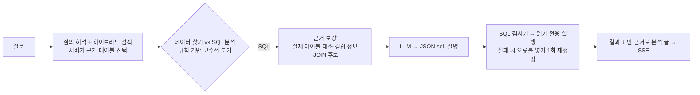

# 카탈로그 메타데이터 RAG 기반 NL2SQL

> 기간: 2026.10 · 상태: 공개 샘플 데이터셋으로 동작 확인 (고객사 적용 전)
>
> 담당: RAG 방식으로 풀자는 설계 방향을 잡고, 앞단 검색 단계를 구현했습니다. SQL 생성·검사·실행·분석 글은 팀원이 구현했고, 구현 결과를 함께 리뷰하며 피드백했습니다.

## 한 줄 요약
AI 대화에서 "부서별 직원 수" 같은 계산 질문을 받으면, **카탈로그 메타데이터를 검색해 관련 테이블을 고르고**, 그 메타데이터만으로 SQL을 만들어 검사 후 읽기 전용으로 실행한 뒤, 결과 표만 근거로 분석 글을 씁니다.

## 왜 RAG로 풀었나
- **문제:** 고객사마다 스키마가 다릅니다. 전체 스키마를 프롬프트에 넣으면 테이블이 많을 때 한도를 넘고, 고객사마다 프롬프트를 고쳐야 합니다.
- **선택지:** 전체 스키마 고정 / 사용자가 테이블 직접 선택 / 질문으로 메타데이터를 검색해 관련 테이블만 전달
- **결정:** 메타데이터 검색. 데이터 카탈로그 솔루션은 이미 고객사 메타데이터를 수집하므로, **수집만 되면 프롬프트를 고치지 않아도 됩니다.**

## 흐름

앞단의 질의 해석·검색·근거 선택은 [AI 검색 사례](01-ai-search-rag.md)에서 제가 만든 단계입니다. 검색이 좋아지면 NL2SQL의 테이블 선택도 같이 좋아집니다.

## 안전장치
- **검사기:** SELECT 한 문장, 허용 목록 테이블만 통과. 쓰기·DDL·시스템 테이블·외부 접속 함수·개인 식별 컬럼·SELECT * 거절. 문자열·주석을 가린 뒤 검사
- **실행 제한:** 쿼리 단위 읽기 전용, 시간·행 수·메모리 상한, LIMIT 강제
- **위조 방지:** 클라이언트가 보낸 테이블 id를 서버가 다시 조회해 실제 적재 테이블만 사용
- **추적:** 프롬프트 해시와 모델명을 답변과 함께 저장해 피드백이 어느 프롬프트에서 나왔는지 구분

## 실험 결과 (표본이 작고 질문을 직접 고른 실험)
- **JOIN 후보 표를 별도 자리로 추가:** 정답 수 1·2 → 5·11 (2회 실행). 4개 이후로는 늘지 않아 4개로 정함
- **JOIN 안내 문장 교체:** JOIN 질문 정답 5·4 → 7·7, 단일 표 질문은 변화 없음
- **표 관계 추정 (정답 관계 15개):** 이름만 11개 / 값만 15개(오탐 7) / 이름+값 혼합 15개(오탐 1)

## 한계와 다음 과제
- 비즈니스 용어·코드값이 SQL 프롬프트에는 아직 들어가지 않습니다. "VIP 고객" 같은 사내 정의가 SQL에 반영되지 않습니다.
- 컬럼을 질문 기준으로 고르지 않고 테이블당 앞에서부터 넣습니다.
- 비슷한 질문과 정답 SQL을 검색해 넣는 예시 기반 RAG가 없습니다.
- 근본적인 안전장치는 읽기 전용 DB 계정과 마스킹입니다.
